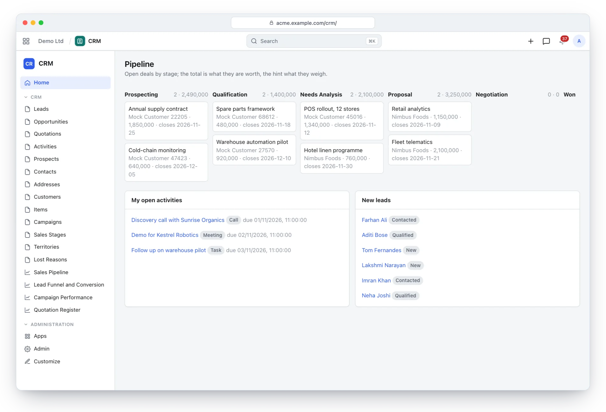
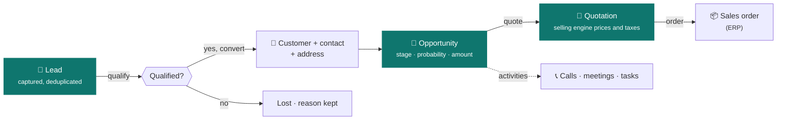
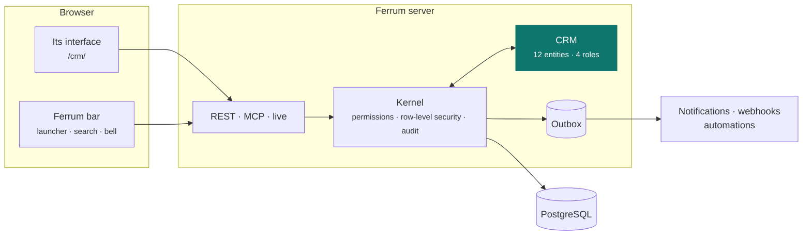
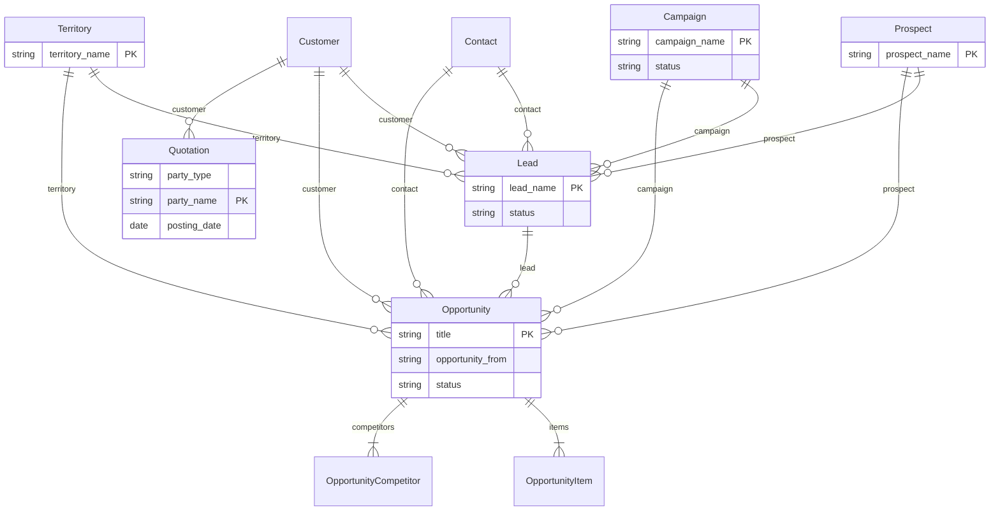

<div align="center">

<picture>
  <source media="(prefers-color-scheme: dark)" srcset="docs/assets/banner-dark.svg">
  
</picture>

[](https://github.com/CBFerrum/ferrum-app-crm/actions/workflows/ci.yml)      

**A native app for [Ferrum](https://github.com/CBFerrum/Ferrum), the open-source, AI-first business platform.**

[Overview](#overview) · [Highlights](#highlights) · [Screenshots](#screenshots) · [How it works](#how-it-works) · [Data model](#data-model) · [Install](#install) · [Develop](#develop) · [Changelog](#changelog)

</div>

---

## Overview

Ferrum CRM takes a lead from first contact to a priced, taxed quotation and on to a sales
order, without leaving Ferrum. Deals move through stages you define, weighted by probability;
calls, meetings and tasks hang off the record they belong to; and quotations are priced by the
same selling engine that invoices them, so what sales promises is what accounting books.


| At a glance | |
|---|---|
| 📦 Version | `0.3.5` |
| 🧱 Platform | Ferrum `>=0.3.2, <0.4` |
| 🔗 Requires | nothing else |
| 🖥️ Interface | its own, at `/crm/` |
| 🗃️ Records | 12 entities in 2 packages |
| 👥 Roles | 4: Sales User, Sales Manager, Marketing Manager, CRM Viewer |
| 📊 Reports | 4 |
| 🧪 Tests | 8 Rust tests, 1 interface test file |


## Highlights

<table>
<tr>
<td width="50%" valign="top">

### 🎯 Lead capture and qualification
Duplicate-safe capture, qualification and one-step conversion to customer, contact and address.

</td>
<td width="50%" valign="top">

### 📈 A pipeline you can trust
Configurable stages and probabilities, a weighted pipeline, competitors and won or lost reasons.

</td>
</tr>
<tr>
<td width="50%" valign="top">

### 🗓️ Every touchpoint
Calls, meetings, emails and tasks on the lead, deal or customer they concern, with owners and due dates.

</td>
<td width="50%" valign="top">

### 🧾 Quotations that become orders
Priced and taxed by the selling engine; ordered quantities flow back to the quotation.

</td>
</tr>
<tr>
<td width="50%" valign="top">

### 📊 Reports that answer questions
Sales pipeline, lead funnel and conversion, campaign performance and a quotation register.

</td>
<td width="50%" valign="top">

### 🔐 Own-records permissions
Assignees own their leads, deals and activities; managers see the team's.

</td>
</tr>
</table>

## Screenshots

<picture>
  <source media="(prefers-color-scheme: dark)" srcset="docs/assets/crm-dark.webp">
  
</picture>

<p align="center"><sub>The pipeline: deals by stage with weighted totals, open activities and new leads.</sub></p>

> [!TIP]
> The screenshots follow your GitHub theme: switch between light and dark to see both.

## How it works

### From first contact to an order



### Inside Ferrum



Everything CRM adds is ordinary Ferrum metadata and Rust: its records get lists, forms,
search, permissions, an audit trail, exports and the REST and MCP APIs for free, so AI agents work
with them under the same rules as people.

### What it adds to Ferrum

| Where | What |
|---|---|
| 🚀 Launcher | **CRM** at `/crm/` |
| ➕ Create menu | Lead |
| ➕ Create menu | Deal |

## Data model

The main records and how they connect (12 entities in all; `packages/` has every field).



### Roles

| Role | What it is for | Entities |
|---|---|---|
| **Sales User** | Works the leads, opportunities and activities they own, and their quotations. | 11 |
| **Sales Manager** | The whole team's CRM records, pipeline and quotations. | 22 |
| **Marketing Manager** | Campaigns and lead generation. | 12 |
| **CRM Viewer** | Read-only access to CRM records and reports. | 11 |

<details>
<summary><b>Reports (4)</b></summary>

- Sales Pipeline
- Lead Funnel
- Campaign Performance
- Quotation Register

</details>

## Install

Workspace administrators install it from **Apps** (`/store/`) in Ferrum; it ships in the
official Ferrum server image. Self-hosters building their own image enable the
`crm` feature of the server. Everything it adds is also available to AI agents over
Ferrum's MCP server, within each person's permissions.

## Develop

Clone it next to the platform:

```text
work/
├── ferrum/            https://github.com/CBFerrum/Ferrum (with Ferrum-Frontend cloned into ferrum/web)
└── ferrum-app-crm/
```

Point the platform dependencies at your checkout (this file is git-ignored):

```toml
# .cargo/config.toml
[patch."https://github.com/CBFerrum/Ferrum"]
ferrum-apps = { path = "../ferrum/crates/apps" }
ferrum-domain = { path = "../ferrum/crates/domain" }
ferrum-kernel = { path = "../ferrum/crates/kernel" }
ferrum-meta = { path = "../ferrum/crates/meta" }
```

The tests need PostgreSQL with an ordinary (non-superuser) role, so row-level security
applies:

```bash
createuser ferrum --pwprompt && createdb -O ferrum ferrum_crm_test
cargo test
```

`FERRUM_CRM_TEST_DATABASE_URL` overrides the database URL.


The interface lives in `ui/` and builds with Ferrum-Frontend's packages:

```bash
cd ui
npm run build      # ui/dist, checked against the size budget
npm test
```

With a development server started with `FERRUM_DEV_UI=1`, `ferrum-app dev --ui` serves the pages
from Vite behind the real bar and session, with hot reload.


### Project layout

```text
app.yaml      the manifest: id, version, requirements, what it adds to Ferrum
packages/     metadata: entities, roles, reports, workflows, print formats
src/          the app's logic in Rust: hooks, actions, endpoints, upkeep jobs
ui/           its own interface (React + Vite), built into ui/dist
tests/        integration tests against a real PostgreSQL
CHANGELOG.md  what changed in each version
```

## Changelog

| Version | Highlights |
|---|---|
| **0.3.5** | The interface starts faster: its first download holds the frame and the app's own pages, and lists, forms, reports and other apps' screens load … |
| **0.3.4** | Record cards (the bar's previews on hover, Ferrum apps-ui.md U5) stay off the pipeline's board, whose rows already show what a card would. |
| **0.3.3** | Rebuilt with Ferrum-Frontend a8d4dda: under the platform's bar the records frame no longer shows a second bell (the bar has notifications). CRM's … |
| **0.3.1** | The launcher draws CRM with an icon (`contact`). |

Every version is in [CHANGELOG.md](CHANGELOG.md).

## License

[AGPL-3.0-only](LICENSE), like the platform. Part of [Ferrum](https://github.com/CBFerrum/Ferrum) ·
[Report an issue](https://github.com/CBFerrum/ferrum-app-crm/issues)
