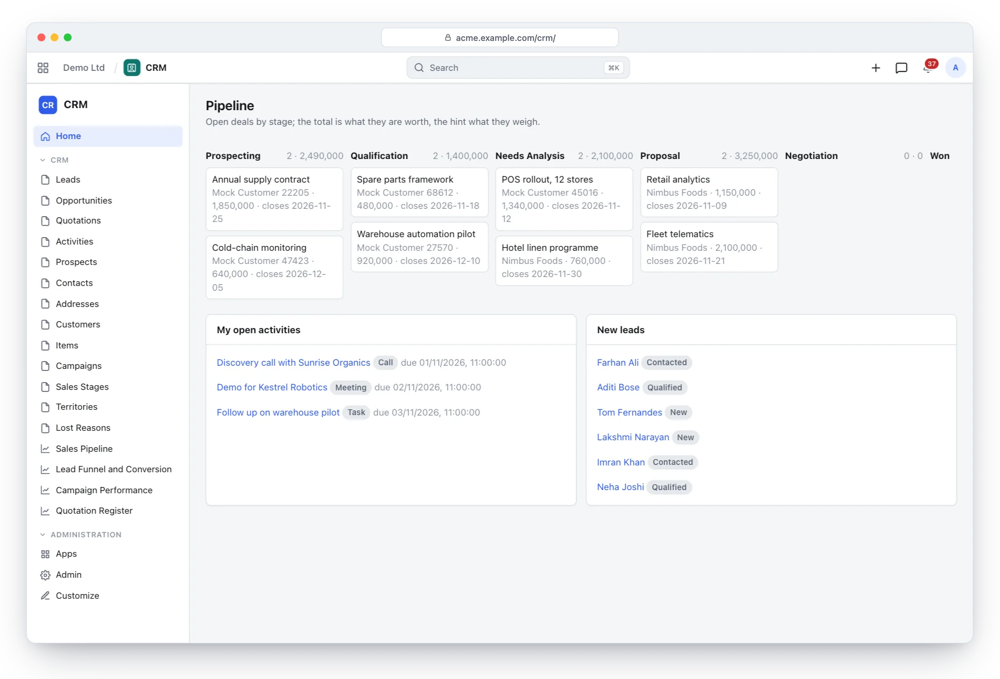
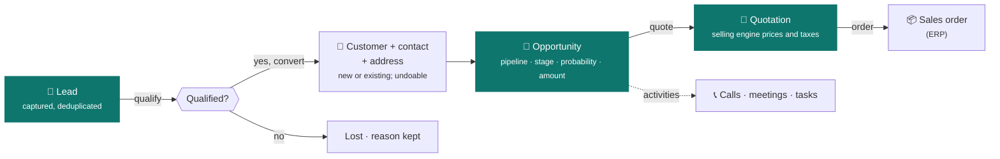
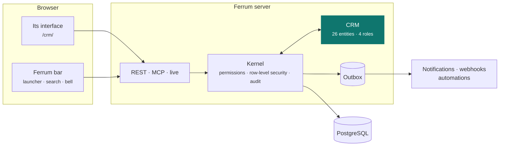
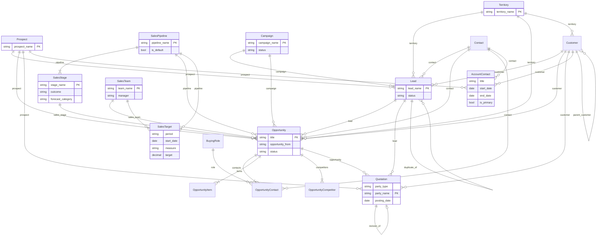

<div align="center">

<picture>
  <source media="(prefers-color-scheme: dark)" srcset="docs/assets/banner-dark.svg">
  
</picture>

[](https://github.com/CBFerrum/ferrum-app-crm/actions/workflows/ci.yml)      

**A native app for [Ferrum](https://github.com/CBFerrum/Ferrum), the open-source, AI-first business platform.**

[Overview](#overview) · [Highlights](#highlights) · [Screenshots](#screenshots) · [How it works](#how-it-works) · [Data model](#data-model) · [Install](#install) · [Develop](#develop) · [Changelog](#changelog)

</div>

---

## Overview

Ferrum CRM takes a lead from first contact to a priced, taxed quotation and on to a sales
order, without leaving Ferrum. Deals move through the stages of pipelines you define (new
business, renewals…), weighted by probability;
calls, meetings and tasks hang off the record they belong to; and quotations are priced by the
same selling engine that invoices them, so what sales promises is what accounting books.
Accounts have owners, territories and parents, and one page that shows everything about them;
teams and territories see their people's records, and targets say how far along each is.


| At a glance | |
|---|---|
| 📦 Version | `0.11.0` |
| 🧱 Platform | Ferrum `>=0.3.2, <0.4` |
| 🔗 Requires | nothing else |
| 🖥️ Interface | its own, at `/crm/` |
| 🗃️ Records | 26 entities in 2 packages |
| 👥 Roles | 4: Sales User, Sales Manager, Marketing Manager, CRM Viewer |
| 📊 Reports | 11 |
| 🧪 Tests | 24 Rust tests, 3 interface test files |


## Highlights

<table>
<tr>
<td width="50%" valign="top">

### 🎯 Lead capture and qualification
One open lead per email or phone, however it is written; enquiries from forms and mail kept and linked to the lead they repeat, and given an owner by assignment rules, in turn or to whoever holds fewest; a lead a rep types in stays theirs unless a rule says otherwise. Conversion to a new or an existing customer and contact, taking the lead's notes along, and undone while nothing else hangs on it.

</td>
<td width="50%" valign="top">

### 📈 A pipeline you can trust
Several pipelines, each with its own stages, probabilities and forecast categories, and what a deal must have before it enters a stage; a weighted pipeline, competitors and won or lost reasons; deals for a lead, a prospect or a customer, with their people and buying roles, lines priced from a price list, and a closed deal reopened where it stood.

</td>
</tr>
<tr>
<td width="50%" valign="top">

### 🗓️ Every touchpoint
Calls, meetings, emails and tasks on the lead, deal or customer they concern, with owners and due dates, a call's outcome and length. Home's My work lists what is due; owners are told of overdue activities, untouched leads, quiet deals and deals with no next step.

</td>
<td width="50%" valign="top">

### 🧾 Quotations that become orders
Priced and taxed by the selling engine. Sent, accepted or rejected with a reason, and revised with the next revision number. An approval is of the quotation's terms, and the orders and invoices made from it keep them; ordered quantities flow back to the quotation.

</td>
</tr>
<tr>
<td width="50%" valign="top">

### 📊 Reports that answer questions
Sales pipeline, and a forecast by owner with commit, best case and pipeline; targets for a person or a team, met or missed, with the forecast beside them; lead funnel and conversion, campaign performance and attribution, a quotation register, win rate, sales cycle, lost reasons and activity by person.

</td>
<td width="50%" valign="top">

### 🔐 Teams, territories and consent
Assignees own their leads, deals and activities; a sales team's manager sees and works the team's, and a territory's sales people those in it, nothing more. Consent to calls and e-mail kept apart, dated and with how it was given; a call to someone on do-not-call says why.

</td>
</tr>
<tr>
<td width="50%" valign="top">

### 🏢 Accounts on one page
A customer's owner, territory and parent; its people at several companies, with their titles and history when they move; its open deals, quotations, orders, invoices and what it owes, open tickets and latest activities, each where its app is installed and the person may read it.

</td>
<td width="50%" valign="top">

### 🔥 Leads that rank themselves
A score from rules a manager sets and recent activity that fades, with a sentence saying why; prospects merged like leads and customers.

</td>
</tr>
</table>

## Screenshots

<picture>
  <source media="(prefers-color-scheme: dark)" srcset="docs/assets/crm-dark.webp">
  
</picture>

<p align="center"><sub>The pipeline: deals by stage with weighted totals, open activities and new leads.</sub></p>

> [!TIP]
> The screenshots follow your GitHub theme: switch between light and dark to see both.

## How it works

### From first contact to an order



### Inside Ferrum



Everything CRM adds is ordinary Ferrum metadata and Rust: its records get lists, forms,
search, permissions, an audit trail, exports and the REST and MCP APIs for free, so AI agents work
with them under the same rules as people.

### What it adds to Ferrum

| Where | What |
|---|---|
| 🚀 Launcher | **CRM** at `/crm/` |
| ➕ Create menu | Lead |
| ➕ Create menu | Deal |
| ➕ Create menu | Contact |
| ➕ Create menu | Quotation |
| ➕ Create menu | Activity |
| 🏠 Home's My work | Sales follow-ups: activities due, leads and deals to follow up |
| 🔔 Notifications | Leads given to you; overdue activities; untouched leads; quiet deals; deals with no next step |

## Data model

The main records and how they connect (26 entities in all; `packages/` has every field).



### Roles

| Role | What it is for | Entities |
|---|---|---|
| **Sales User** | Works the leads, opportunities and activities they own, and their quotations; a team's manager works its team's too, and a territory's sales people the leads and deals in it. | 22 |
| **Sales Manager** | The whole team's CRM records, pipeline and quotations. | 32 |
| **Marketing Manager** | Campaigns and lead generation. | 16 |
| **CRM Viewer** | Read-only access to CRM records and reports. | 16 |

<details>
<summary><b>Reports (11)</b></summary>

- Sales Pipeline (one pipeline, or all)
- Sales Forecast (by owner or month: closed, commit, best case, pipeline and weighted)
- Sales Targets (a person's or a team's: target, achieved, gap, commit and best case)
- Lead Funnel
- Campaign Performance
- Campaign Attribution (linear, first or last touch)
- Quotation Register
- Win Rate (by owner, source or month)
- Sales Cycle (by owner, or days in each stage)
- Lost Reasons (with competitors)
- Activity by Person (by month, week or day)

</details>

## Install

Workspace administrators install it from **Apps** (`/store/`) in Ferrum; it ships in the
official Ferrum server image. Self-hosters building their own image enable the
`crm` feature of the server. Everything it adds is also available to AI agents over
Ferrum's MCP server, within each person's permissions.

## Develop

Clone it next to the platform:

```text
work/
├── ferrum/            https://github.com/CBFerrum/Ferrum (with Ferrum-Frontend cloned into ferrum/web)
└── ferrum-app-crm/
```

Point the platform dependencies at your checkout (this file is git-ignored):

```toml
# .cargo/config.toml
[patch."https://github.com/CBFerrum/Ferrum"]
ferrum-apps = { path = "../ferrum/crates/apps" }
ferrum-domain = { path = "../ferrum/crates/domain" }
ferrum-kernel = { path = "../ferrum/crates/kernel" }
ferrum-meta = { path = "../ferrum/crates/meta" }
```

The tests need PostgreSQL with an ordinary (non-superuser) role, so row-level security
applies:

```bash
createuser ferrum --pwprompt && createdb -O ferrum ferrum_crm_test
cargo test
```

`FERRUM_CRM_TEST_DATABASE_URL` overrides the database URL.


It also builds on [ferrum-app-erp](https://github.com/CBFerrum/ferrum-app-erp), which Cargo takes from GitHub.
To work on it alongside this app, clone it into the same folder and add to the same file:

```toml
[patch."https://github.com/CBFerrum/ferrum-app-erp"]
ferrum-app-erp = { path = "../ferrum-app-erp" }
```


The interface lives in `ui/` and builds with Ferrum-Frontend's packages:

```bash
cd ui
npm run build      # ui/dist, checked against the size budget
npm test
```

With a development server started with `FERRUM_DEV_UI=1`, `ferrum-app dev --ui` serves the pages
from Vite behind the real bar and session, with hot reload.


### Project layout

```text
app.yaml      the manifest: id, version, requirements, what it adds to Ferrum
packages/     metadata: entities, roles, reports, workflows, print formats
src/          the app's logic in Rust: hooks, actions, endpoints, upkeep jobs
ui/           its own interface (React + Vite), built into ui/dist
tests/        integration tests against a real PostgreSQL
CHANGELOG.md  what changed in each version
```

## Changelog

| Version | Highlights |
|---|---|
| **0.11.2** | Rebuilt on the tuned design system: better menu icons, a lighter first page, a visible scroll cue, cleaner print. |
| **0.11.1** | The redesigned interface: the upgraded design system, shaped loading, told-apart states. |
| **0.11.0** | Accounts with an owner, a territory and a parent, on one page; contacts at several companies and moving between them; sales teams and territories seeing their people's records; targets; consent to calls and e-mail; prospects merged; lead scoring. |
| **0.10.0** | Several pipelines; what a stage asks of a deal entering it; a deal's people with buying roles; deal lines priced from a price list, with units and discounts; quotations sent, accepted or rejected, and revised; a forecast by owner and category. |
| **0.9.0** | Leads shared out by assignment rules; reminders and My work; days in stage and last activity; call outcomes; win rate, sales cycle, lost reasons and activity reports. |
| **0.8.0** | Duplicates by email or phone, kept or refused; conversion onto existing contacts, and undone; deals reopened, and for prospects. |
| **0.7.0** | An approval is of a quotation's terms; the orders and invoices made from it keep what it quoted. |
| **0.6.17** | Its reports' names in Arabic and Hindi. |
| **0.6.16** | Its names in Arabic and Hindi; the last English sentences translated. |
| **0.6.15** | Sentences built in code are words too, in Arabic and Hindi. |
| **0.6.14** | The assistant knows its records. |
| **0.6.13** | Rebuilt with Ferrum-Frontend 5b22e7b: its own words in Arabic and Hindi. |
| **0.6.12** | Rebuilt with Ferrum-Frontend 6537d65: once-shown answers kept; English isolated right to left; its own words translatable by a workspace. |
| **0.6.11** | Rebuilt with Ferrum-Frontend d5d98f2: a workspace's own interface words; pictures in attachment fields; a duplicate value said so; its own screens mirror right to left. |
| **0.6.10** | Rebuilt with Ferrum-Frontend 63280d3: right to left, pages mirror; the records pages' words in Arabic and Hindi. |
| **0.6.9** | Rebuilt with Ferrum-Frontend a64416a: a box whose default is 1 shows ticked. |
| **0.6.8** | Rebuilt with Ferrum-Frontend 922fcfb: action dialogs say every refusal and ask once. |
| **0.6.7** | Rebuilt with Ferrum-Frontend a76295e: times on a person's own clock when they chose one. |
| **0.6.6** | Times on the workspace's clock; rebuilt with Ferrum-Frontend 24c3951. |
| **0.6.5** | Rebuilt with Ferrum-Frontend bb60115: empty numbers read as the server reads them; settings open as their record. |
| **0.6.4** | Dates are the workspace's, not UTC's. |
| **0.6.3** | Mark as Lost asks for its reason, Convert to Customer for an existing customer. |
| **0.6.2** | A quotation's status says it becomes an order through ERP and the CRM and ERP connector. |
| **0.6.1** | Rebuilt with Ferrum-Frontend 00dea07: a workflow state's kept fields are read-only, its needed ones required. |
| **0.6.0** | email clicks as attribution touches |
| **0.5.1** | A draft quotation that breaks the product rules has an action, Add What the Rules Need: it adds each item a line requires and the shortfall of one needed per … |
| **0.5.0** | Campaign attribution and product rules |
| **0.4.3** | Personal-data requests find lead records by the person's phone number as well as their email, and list the lead records holding their name apart, for an … |
| **0.4.2** | Rebuilt with Ferrum-Frontend daeadda: after an action runs, a record page shows what the action said it did rather than only that it is done. |
| **0.4.1** | Rebuilt with Ferrum-Frontend 80ff179: a field's label names its control for assistive technology, and a record whose title is a link shows that record's title, … |
| **0.4.0** | The pipeline is a board: drag a deal between stages, see what each is worth, drop it on Won or Lost. Touch screens and keyboards have the same moves from each … |
| **0.3.5** | The interface starts faster: its first download holds the frame and the app's own pages, and lists, forms, reports and other apps' screens load … |
| **0.3.4** | Record cards (the bar's previews on hover, Ferrum apps-ui.md U5) stay off the pipeline's board, whose rows already show what a card would. |
| **0.3.3** | Rebuilt with Ferrum-Frontend a8d4dda: under the platform's bar the records frame no longer shows a second bell (the bar has notifications). CRM's … |
| **0.3.1** | The launcher draws CRM with an icon (`contact`). |

Every version is in [CHANGELOG.md](CHANGELOG.md).

## License

[AGPL-3.0-only](LICENSE), like the platform. Part of [Ferrum](https://github.com/CBFerrum/Ferrum) ·
[Report an issue](https://github.com/CBFerrum/ferrum-app-crm/issues)
